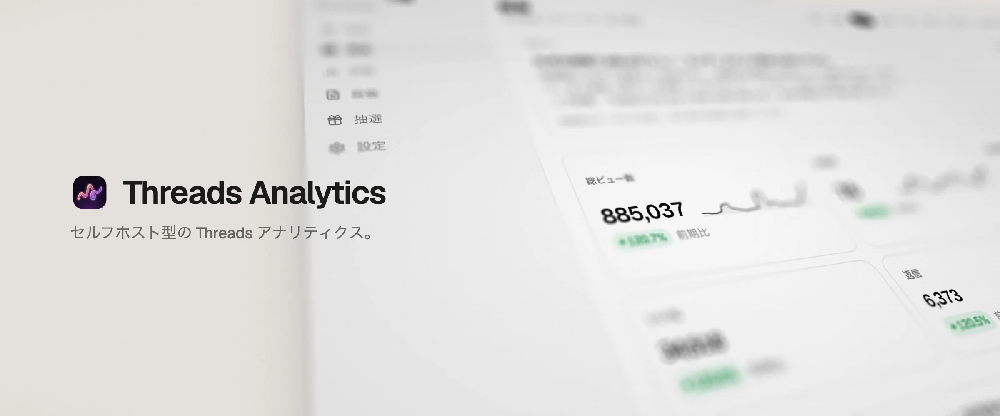
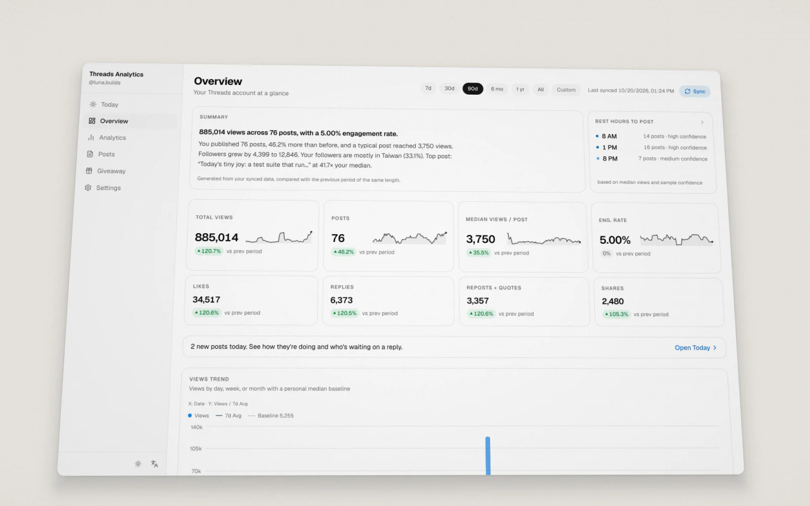
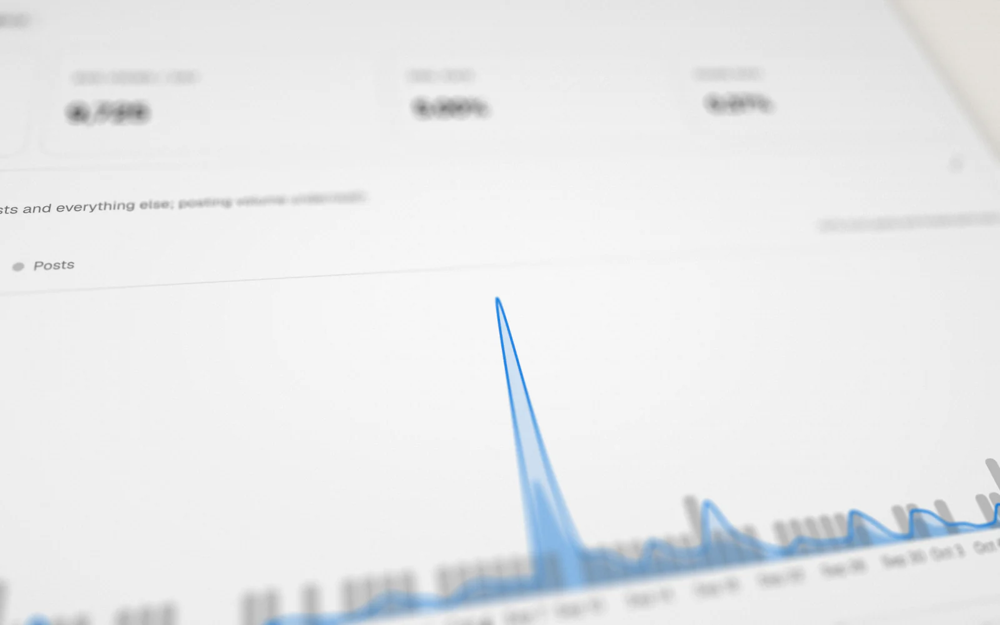
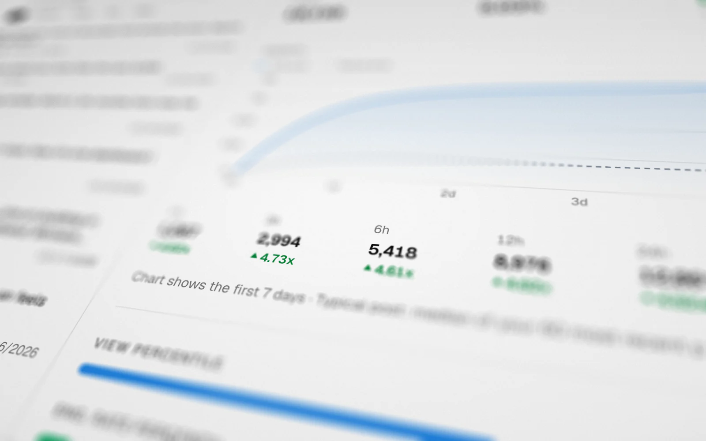
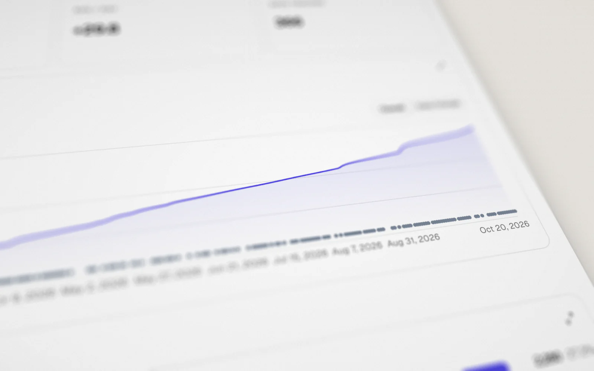

<p align="center">
  <a href="https://threads-analytics.app/ja">
    <picture>
      <source media="(prefers-color-scheme: dark)" srcset="docs/images/readme/banner-ja-dark.webp" />
      
    </picture>
  </a>
</p>
<p align="center">
  セルフホスト型の Threads アナリティクスダッシュボード。アクセストークンを接続すると、詳細なチャートと指標で投稿パフォーマンスを分析できます。
</p>
<p align="center">
  <a href="https://github.com/ridemountainpig/threads-analytics/stargazers"></a>
  <a href="./LICENSE"></a>
  <a href="https://github.com/ridemountainpig/threads-analytics/pkgs/container/threads-analytics"></a>
</p>
<p align="center">
  <a href="./README-zh.md">繁體中文</a> · <a href="./README.md">English</a> · <a href="./README-ja.md">日本語</a>
</p>
<p align="center">
  <a href="https://threads-analytics.app/ja"><strong>公式サイト</strong></a> · <a href="https://threads-analytics.app/ja#demo">ライブデモ</a> · <a href="https://threads-analytics.app/ja/token-guide">トークン取得ガイド</a>
</p>

---

## 目次

- [機能](#機能)
- [macOS デスクトップ版](#macos-デスクトップ版)
- [クイックスタート](#クイックスタート)
- [Threads アクセストークンの取得](#threads-アクセストークンの取得)
- [MCP サーバー](#mcp-サーバー)
- [デプロイ](#デプロイ)
  - [Docker Compose](#docker-compose)
  - [Docker](#docker)
  - [Vercel](#vercel)
  - [自動同期](#自動同期)
  - [既存デプロイの更新](#既存デプロイの更新)
- [開発セットアップ](#開発セットアップ)
- [アナリティクスリファレンス](#アナリティクスリファレンス)
- [ライセンス](#ライセンス)

---

## 機能

- **今日** — 今日のすべての数値を 1 ページに：今日の投稿の合計と返信待ち・フォロワー増減、投稿リズムと最適な時間帯、今日の各投稿のすべての数値、昨日の投稿と今日増えた分、返信待ちのものがわかる今日の返信一覧（Threads からリアルタイムで取得し、保存はしません）
- **概要** — 統計カード（ビュー、いいね、リプライ、リポスト、引用、シェア、エンゲージメント率）と前期比、ビュー推移チャート（日／週／月）、最適投稿時間の推奨、バイラル投稿
- **アナリティクス** — **パフォーマンス**、**コンテンツ**、**オーディエンス**の 3 タブにまたがる 31 種類のチャート
- **投稿** — 検索・フィルタ可能なリストと投稿ごとのアナリティクスパネル（投稿後 1 週間の伸びのグラフを含む）
- **プレゼント抽選** — 投稿へのリプライから当選者を抽選。キーワード、友達のタグ付け、締め切り、1 アカウント 1 回などの条件を組み合わせ、自分のダッシュボード内で完結
- **MCP サーバー** — Claude などの AI エージェントが OAuth 保護されたエンドポイント経由でアナリティクスを照会可能
- 複数アカウント対応、アカウント切り替え可能
- 設定可能な間隔での自動同期
- アクセストークンの自動更新 — 一度接続すれば、60 日ごとに手動で貼り直す必要はありません
- パスワード保護（単一の `APP_PASSWORD` 環境変数）
- English / 繁體中文 / 日本語 UI、ライト・ダーク・自動の外観に対応

<table>
  <tr>
    <td width="50%" valign="top">
      <picture>
        <source media="(prefers-color-scheme: dark)" srcset="docs/images/readme/overview-dark.webp" />
        
      </picture>
      <p align="center"><b>概要</b> · アカウントの状況をひと目で</p>
    </td>
    <td width="50%" valign="top">
      <picture>
        <source media="(prefers-color-scheme: dark)" srcset="docs/images/readme/today-dark.webp" />
        
      </picture>
      <p align="center"><b>今日</b> · 今日の投稿と、返信を待っているリプライ</p>
    </td>
  </tr>
  <tr>
    <td width="50%" valign="top">
      <picture>
        <source media="(prefers-color-scheme: dark)" srcset="docs/images/readme/analytics-dark.webp" />
        
      </picture>
      <p align="center"><b>アナリティクス</b> · アカウントのビューを流入元ごとに表示</p>
    </td>
    <td width="50%" valign="top">
      <picture>
        <source media="(prefers-color-scheme: dark)" srcset="docs/images/readme/posts-dark.webp" />
        
      </picture>
      <p align="center"><b>投稿</b> · 各投稿の公開後 1 週間の伸び</p>
    </td>
  </tr>
  <tr>
    <td width="50%" valign="top">
      <picture>
        <source media="(prefers-color-scheme: dark)" srcset="docs/images/readme/audience-dark.webp" />
        
      </picture>
      <p align="center"><b>オーディエンス</b> · フォロワーの伸びと所在地</p>
    </td>
    <td width="50%" valign="top">
      <picture>
        <source media="(prefers-color-scheme: dark)" srcset="docs/images/readme/giveaway-dark.webp" />
        
      </picture>
      <p align="center"><b>プレゼント抽選</b> · 投稿へのリプライから当選者を抽選</p>
    </td>
  </tr>
</table>

---

## macOS デスクトップ版

Apple Silicon 搭載 Mac（M1 以降）では、[GitHub Releases](https://github.com/ridemountainpig/threads-analytics/releases) からデスクトップ版を直接ダウンロードできます。Node.js、pnpm、PostgreSQL を別途インストールする必要はありません。現在、Intel Mac 版は提供していません。

ダウンロード、初回起動、アップデート、アンインストールの手順は、[Mac アプリのガイド](https://threads-analytics.app/ja/desktop)を参照してください。

デスクトップ版をソースからビルドする場合は、[デスクトップ版 README](./desktop/README-ja.md)を参照してください。

---

## クイックスタート

最速でインスタンスを立ち上げる方法は Railway のワンクリックテンプレートです — PostgreSQL データベースのプロビジョニングと必要な環境変数の設定を自動で行います：

[](https://railway.com/deploy/zibjsX?referralCode=vPBCb4&utm_medium=integration&utm_source=template&utm_campaign=generic)

AI コーディングエージェント（Claude Code、Codex、Cursor など）に任せることもできます。各エージェントデプロイガイドには、エージェントに貼り付けるだけでデータベースの作成、デプロイ、URL の報告まで自動で行うプロンプトが用意されています：[Railway](https://threads-analytics.app/ja/deploy/railway-agent) · [Vercel](https://threads-analytics.app/ja/deploy/vercel-agent)

すでにサーバーがある場合は、[Docker Compose](#docker-compose) でアプリと PostgreSQL をコマンド 1 つでまとめて起動できます。既存のデータベースがあるなら、ビルド済みイメージを直接実行することもできます（詳細は [Docker](#docker)）。

アプリが起動したら `APP_PASSWORD` でサインインし、Threads アカウントを接続します — 次のセクションを参照してください。ソースから実行する場合は[開発セットアップ](#開発セットアップ)へ。

---

## Threads アクセストークンの取得

1. [developers.facebook.com](https://developers.facebook.com) で **Access the Threads API** use case を含むアプリを作成
2. **アクセストークン**を生成
3. ダッシュボードで **設定 → Threads アカウントを追加 → トークンを貼り付け**

スクリーンショット付きの詳しい手順は [Threads アクセストークンの生成方法](https://threads-analytics.app/ja/token-guide) を参照してください。

トークンの有効期限は 60 日間で、アプリが自動的に更新します：

- 同期のたびにトークンを確認し、残り 30 日を切ると自動的に 60 日間延長されます（Threads API は発行から 24 時間以上経過したトークンのみ更新可能）。
- 設定のアカウントカードにトークンの有効期限と最後の自動更新日時が表示されます。
- それでもトークンが期限切れになった場合（アプリが長期間停止して同期が走らなかったなど）はダッシュボードに警告が表示されます。新しいトークンを生成し、アカウントカードの**トークンを更新**ボタンから貼り付けてください。同期済みのデータはそのまま保持されます。

---

## MCP サーバー

ダッシュボードにはリモート [MCP](https://modelcontextprotocol.io) サーバー（`/api/mcp`、Streamable HTTP）が組み込まれており、Claude などの AI エージェントが同期済みの Threads データ——投稿、集計アナリティクス、フォロワー履歴——を直接照会し、質問への回答やレポート作成に利用できます。すべて**読み取り専用**です。

### エージェントの接続

認証は OAuth 2.1（PKCE + Dynamic Client Registration）で、API キーのコピーは不要です。初回接続時にクライアントが自動登録され、ブラウザでダッシュボードのログイン（`APP_PASSWORD`）が開き、同意画面でアクセスを承認します。

**Claude Code**

```bash
claude mcp add --transport http threads-analytics https://your-deployment.example.com/api/mcp
```

その後、Claude Code 内で `/mcp` を実行して OAuth サインインを完了します。

**Claude（Web / デスクトップ）** — 設定 → Connectors → **Add custom connector** で `https://your-deployment.example.com/api/mcp` を貼り付けます。

接続済みクライアントは**設定 → 接続済みエージェント**に表示され、いつでも取り消せます。

### ツール

| ツール                 | 機能                                                                                                                                                                                                                   |
| ---------------------- | ---------------------------------------------------------------------------------------------------------------------------------------------------------------------------------------------------------------------- |
| `get_account_overview` | 接続済み全アカウントのユーザー名、同期状態、投稿数、データ期間、フォロワー成長サマリー——最初に呼ぶことを推奨                                                                                                           |
| `get_today`            | 現時点での今日の状況：アカウントのビュー、フォロワーの増減、今日と昨日の投稿を中央値および直近の投稿の同時点の伸びと比較、そして通常もっとも成果が出る時間帯                                                           |
| `list_posts`           | 指標付き投稿リスト。期間指定、並び替え（日付／ビュー／いいね／エンゲージメント率）、メディアタイプフィルタ、全文検索、ページング                                                                                       |
| `get_post`             | 単一投稿の全詳細（全文と、投稿後 1 時間・3 時間・6 時間・12 時間・24 時間・48 時間・7 日時点の成果を含む）                                                                                                             |
| `get_thread`           | 連投スレッドの全パート：ルート投稿と作者自身の続きの投稿。各パートの全文・成果・前のパートからの間隔と、ルートの閲覧者をどれだけ引き継げたか（通常の残存率との比較付き）                                               |
| `get_post_benchmark`   | 1 件の投稿を期間内の他の投稿と比較：全体およびメディア種別ごとの中央値に対するビュー、ビューとエンゲージメント率のパーセンタイル、各インタラクション率と中央値、同じ文章特徴を持つ投稿の傾向                           |
| `compare_post_growth`  | 投稿後の同じ経過時間（例：24 時間後のビュー数）で投稿を比較し、中央値と並べてランキング。まだその時点に達していない新しい投稿も、同じ経過時間の他の投稿と比べて先行しているか遅れているかを判定                        |
| `get_analytics`        | 期間内の 31 種類の集計アナリティクスセクション（最適投稿時間、キーワード分析、ビュー分布、投稿ストリークなど）。必要な分だけ取得                                                                                       |
| `get_follower_history` | 日次フォロワースナップショットと成長サマリー。オプションで最新のオーディエンス構成                                                                                                                                     |
| `compare_periods`      | 2 期間のコア指標を絶対値・パーセント変化付きで比較（アカウント全体のビューを含む）。比較期間は直前の同じ長さの期間がデフォルト                                                                                         |
| `get_monthly_review`   | 1 か月を比較月（デフォルトは前月。前年同月など任意の過去月も指定可）と直近数か月の基準期間で比較。KPI、ベスト／ワースト投稿、フォロワー増加日、コンテンツ構成、スレッド、週ごとの推移。先月の実験を渡すと 1 つずつ判定 |

複数のアカウントを接続している場合、`get_account_overview` 以外のすべてのツールは `account` 引数（ユーザー名または id）を受け取ります。省略するとツールはアカウント一覧を返し、エージェントは推測せずにどのアカウントかを尋ねます。

`YYYY-MM-DD` で指定した日付は、分析タイムゾーン（デフォルトは Asia/Taipei、デスクトップアプリでは Mac のタイムゾーン）の丸 1 日を表します。`list_posts`・`get_post_benchmark`・`get_today`・`compare_post_growth`・`get_analytics`・`compare_periods`・`get_monthly_review` は `timezone` 引数で別のタイムゾーンを指定することもできます。

投稿の伸び（`get_post` の各時点の成果と `compare_post_growth`）は、投稿後 30 日間に同期ごとに記録される成果から求めます。記録は投稿直後ほど細かく（最短 15 分ごと）、後半は 1 日 1 回です。この機能を追加したバージョンから記録が始まるため、それ以前の投稿には伸びのデータがありません。同期の頻度が高いほど、投稿直後の曲線が細かくなります。

### プロンプト

サーバーには既製のプロンプトも登録されています。多くはオプションの `period` 引数（`30d`、`90d`、日付範囲など）を受け取り、`monthly-review` は `month`（`YYYY-MM`）と、オプションで先月のレビューの `previous_experiments` を受け取ります：

| プロンプト             | 生成内容                                                                                                                                                |
| ---------------------- | ------------------------------------------------------------------------------------------------------------------------------------------------------- |
| `performance-review`   | トレンド、ベスト／ワースト投稿、改善アクションを含む成果レポート                                                                                        |
| `content-strategy`     | 有効なフォーマット・長さ・トピックと推奨コンテンツミックス                                                                                              |
| `posting-schedule`     | オーディエンスの反応時間に基づく具体的な週間投稿スケジュール                                                                                            |
| `viral-post-breakdown` | バイラル投稿の深掘りと再現可能なパターンの抽出                                                                                                          |
| `audience-insights`    | フォロワー成長と構成、コンテンツ・タイミングへの示唆                                                                                                    |
| `topic-analysis`       | 成果を生むトピックと文章パターン、新しい投稿アイデア                                                                                                    |
| `monthly-review`       | 先月の実験を採点し、新しい実験を 3 つ提案する月次レビュー。実験はクライアント側に保存し（例：`threads-reviews/YYYY-MM.md`）、サーバーには書き込みません |

---

## デプロイ

このセクションの内容は、ウェブサイトの[セルフホストガイド](https://threads-analytics.app/ja/deploy/self-host)でステップごとに解説しています：Docker Compose、Docker、ソースからの実行、Vercel Cron、環境変数、自動同期、更新。

### Docker Compose

[`docker-compose.yml`](./docker-compose.yml) は、ダッシュボードを専用の PostgreSQL と一緒に起動します。先にデータベースを用意する必要はありません。空のフォルダでファイルをダウンロードし、隣に `.env` を作ります：

```bash
curl -fsSLO https://raw.githubusercontent.com/ridemountainpig/threads-analytics/main/docker-compose.yml
cat > .env <<EOF
APP_PASSWORD=$(openssl rand -hex 12)
TOKEN_ENCRYPTION_KEY=$(openssl rand -hex 32)
POSTGRES_PASSWORD=$(openssl rand -hex 16)
EOF
grep APP_PASSWORD .env
docker compose up -d
```

`grep` で表示される `APP_PASSWORD` がサインイン用のパスワードなので、控えておいてください。自分で決めたい場合は `.env` を書き換えて、もう一度 `docker compose up -d` を実行します。Compose はデータベースの準備を待ってマイグレーションを実行し、ポート 3000 でダッシュボードを提供します。同期スケジューラもオンで、`DATABASE_URL` と `SYNC_SCHEDULER_ENABLED` は設定済みです。`.env` のほかの変数（`CRON_SECRET` など）もアプリに渡されます。

データは `postgres-data` ボリュームに保存され、再起動や更新でも残ります。PostgreSQL が `POSTGRES_PASSWORD` を読むのはボリュームを最初に作るときだけなので、最初の値を使い続けてください。また `docker compose down -v` はボリュームごと削除し、同期済みの投稿もすべて消えます。

### Docker

すでに PostgreSQL があり、アプリのコンテナだけを動かす場合は、GitHub Container Registry で公開されているビルド済みのマルチアーキテクチャ（amd64/arm64）イメージを使います。[環境変数](#2-環境変数の設定)を設定後、次を実行：

```bash
docker run -p 3000:3000 --env-file .env.local ghcr.io/ridemountainpig/threads-analytics:latest
```

ソースから自分でビルドすることもできます：

```bash
docker build -t threads-analytics .
docker run -p 3000:3000 --env-file .env.local threads-analytics
```

Docker イメージは起動時に `prisma migrate deploy` を自動実行します。

### Vercel

リポジトリを Vercel にインポートし、[環境変数](#2-環境変数の設定)を設定します。`vercel-build` スクリプト（`prisma generate && prisma migrate deploy && next build`）が、ビルド時に Prisma Client の生成とマイグレーションを実行します。Vercel はこのスクリプトがあれば `build` より優先します。

Vercel は長時間実行プロセスをサポートしていないため、内蔵の同期スケジューラは動作しません。代わりに [Vercel Cron Jobs](https://vercel.com/docs/cron-jobs) を使って `/api/cron/sync` をスケジュール実行してください：

1. プロジェクトルートに `vercel.json` を追加：

   ```json
   {
     "crons": [
       {
         "path": "/api/cron/sync",
         "schedule": "0 * * * *"
       }
     ]
   }
   ```

   `schedule` は Settings で設定した同期間隔に合わせます（例: 毎時 `0 * * * *`、30 分ごと `*/30 * * * *`）。Vercel の無料プランでは cron の頻度に制限があるので注意してください。

2. Vercel ダッシュボードの **Settings → Environment Variables** で以下を追加：

   | 変数          | 値                                                     |
   | ------------- | ------------------------------------------------------ |
   | `CRON_SECRET` | ランダムなシークレット — `openssl rand -hex 32` で生成 |

   Vercel は cron リクエストのたびに `Authorization: Bearer <CRON_SECRET>` を自動的に付与し、`/api/cron/sync` ルートがこの値を使って正当なリクエストかを検証します。

### 自動同期

常時稼働のデプロイ環境（Docker / VPS / Railway）では `SYNC_SCHEDULER_ENABLED=true` を設定します（Docker Compose では設定済み）。内蔵スケジューラがサーバー起動とともに開始し、設定で構成された間隔で接続済みのすべてのアカウント（アクティブなものだけでなく）を同期します。Vercel では上記の cron 設定を使用してください。

<a id="updating"></a>

### 既存デプロイの更新

新しいバージョンは更新された Docker イメージとして公開され、公式イメージで動かしている場合は新しいバージョンが出るとダッシュボードに更新バナーが表示されます。データベースマイグレーションは起動時に自動実行されるため、更新に必要なのは新しいイメージまたはコードの取得だけです：

- **Docker Compose** — `docker-compose.yml` のあるフォルダで次を実行：

  ```bash
  docker compose pull
  docker compose up -d
  ```

- **Docker / VPS** — 最新イメージを取得し、古いコンテナを停止して同じフラグで再起動：

  ```bash
  docker pull ghcr.io/ridemountainpig/threads-analytics:latest
  ```

- **Railway** — Railway ダッシュボードからサービスの再デプロイをトリガーします。
- **ソースからデプロイ** — `git pull` 後に `pnpm install && pnpm prisma:generate && pnpm build` を実行し、`pnpm start` で再起動します（マイグレーションは自動実行）。
- **Vercel** — 新しいバージョンを push するだけです。マイグレーションは上記のとおりビルド時に実行されます。

各リリースのイメージにはバージョンのタグ（例：`1.0.0`）と、そのシリーズの最新版を指す `1.0`・`1` のタグも付くため、Docker や Docker Compose では `latest` の代わりにこれらのタグでバージョンを固定できます（Compose では `image:` の行を変更）。各バージョンの変更内容は [GitHub Releases](https://github.com/ridemountainpig/threads-analytics/releases) をご覧ください。

更新してもデータベース（投稿、インサイト、アカウント）はそのまま保持されます。

---

## 開発セットアップ

動作要件：Node.js 22.12+ または 24+、pnpm、PostgreSQL データベース。

### 1. クローンとインストール

```bash
git clone https://github.com/ridemountainpig/threads-analytics.git
cd threads-analytics
pnpm install
pnpm prisma:generate
```

### 2. 環境変数の設定

```bash
cp .env.example .env.local
```

続いて各値を設定します：

| 変数                     | 説明                                         | 生成方法                |
| ------------------------ | -------------------------------------------- | ----------------------- |
| `APP_PASSWORD`           | ダッシュボードにアクセスするためのパスワード | 任意の文字列を設定      |
| `DATABASE_URL`           | PostgreSQL の接続文字列                      | DB プロバイダから取得   |
| `TOKEN_ENCRYPTION_KEY`   | 保存された Threads アクセストークンを暗号化  | `openssl rand -hex 32`  |
| `CRON_SECRET`            | 本番環境で `/api/cron/sync` を保護           | 16 文字以上のランダム値 |
| `SYNC_SCHEDULER_ENABLED` | 内蔵のポーリングスケジューラを有効化         | Docker/VPS は `true`    |

### 3. データベースマイグレーションの実行

```bash
npx prisma migrate dev
```

### 4. 開発サーバーの起動

```bash
pnpm dev
```

[http://localhost:3000](http://localhost:3000) を開き、`APP_PASSWORD` でサインインします。

### 5. Threads アカウントの接続

1. サイドバーの**設定**を開く
2. **Threads アカウントを追加**をクリック
3. 長期アクセストークンを貼り付ける（[アクセストークンの取得方法](#threads-アクセストークンの取得)を参照）
4. アカウント追加後、最初の同期が自動的に開始されます（数分かかる場合があります）

### よく使うコマンド

```bash
pnpm dev          # 開発サーバーを起動
pnpm build        # 本番用ビルド
pnpm start        # マイグレーションを実行して本番サーバーを起動
npx prisma studio # データベース GUI を開く
npx prisma migrate dev --name <name>  # 新しいマイグレーションを作成
```

---

## アナリティクスリファレンス

ダッシュボードは概要、アナリティクス（パフォーマンス／コンテンツ／オーディエンス）、投稿の各ページで 31 種類のチャートを提供します。[ウェブサイト](https://threads-analytics.app/ja/analytics)ではデモデータで閲覧できます。各チャートの表示内容とオーディエンス指標のサンプリングルールは、**[アナリティクスリファレンス](./docs/analytics-ja.md)**に完全にまとめられています。

---

## ライセンス

Threads Analytics は [GNU Affero General Public License v3.0](./LICENSE) のオープンソースです。セルフホスト、改変、再配布は自由ですが、改変したバージョンをネットワークサービスとして提供する場合は、そのソースコードを同じライセンスで公開する必要があります。
